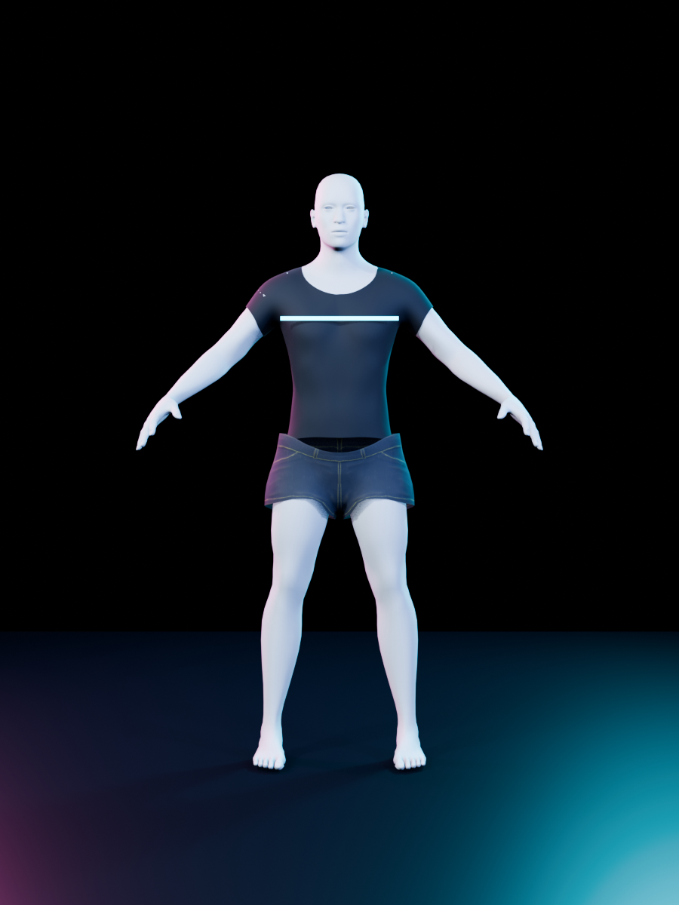

# Light Fashion

Light Fashion is an early-stage wearable-electronics project exploring a fitted
black shirt with a removable, diffused cyan addressable-LED bar across the
chest. The immediate goal is a safe, reproducible single-strip prototype; more
elaborate 1980s/1990s-inspired designs can build on that process later.



> [!WARNING]
> This is an experimental prototype, not a certified consumer garment. Read
> [the safety notes](docs/SAFETY.md) before powering or wearing any assembly.

## Current status

There are two deliberately separate configurations:

| Configuration | Controller | Pixels | Power | Purpose |
|---|---|---:|---|---|
| Tonight's bench test | Adafruit HUZZAH32 ESP32 Feather | 18 pixels on a 30 cm piece of 60 LED/m WS2812 strip | 5 V USB wall adapter | Verify wiring, firmware, color, brightness, and diffusion |
| Modeled wearable concept | Seeed XIAO-size controller | 10 pixels at 30 LED/m | Protected 3.7 V LiPo | Explore garment fit, component placement, and removable construction |

The Blender scene is a design study, not an electrical specification. The
physical prototype currently uses the hardware identified in
[the hardware inventory](docs/HARDWARE.md).

## Tonight's bench test

Use only a cut 30 cm section of the strip—not the five-meter reel—and start at
10% brightness.

- [Bench-test instructions](docs/BENCH_TEST.md)
- [Illustrated HUZZAH32 wiring diagram](diagrams/huzzah32-neopixel-usb-wiring.html)
- [Adafruit HUZZAH32 pinout](https://learn.adafruit.com/adafruit-huzzah32-esp32-feather/pinouts)
- [Adafruit NeoPixel best practices](https://learn.adafruit.com/adafruit-neopixel-uberguide/best-practices)

## Repository layout

```text
blender/
  scenes/       Authored Blender source scenes
  scripts/      Repeatable scene-building and rendering scripts
  renders/      Selected output images used for review and documentation
  assets/       Local third-party assets; downloads are ignored by Git
diagrams/       Mermaid sources, exported PNGs, and the bench wiring diagram
docs/           Hardware, bench-test, safety, and project decisions
electronics/    Future KiCad schematic and PCB project
patterns/       Future sewing patterns and construction notes
references/     Source links and locally ignored research material
```

## Rebuilding the Blender proof of concept

The scripts currently target Blender 5.2. From PowerShell at the repository
root:

```powershell
& 'C:\Program Files\Blender Foundation\Blender 5.2\blender.exe' `
  --background `
  --factory-startup `
  'blender\scenes\led_outfit_vest_v001.blend' `
  --python 'blender\scripts\build_led_chest_poc.py'
```

See [the Blender script documentation](blender/scripts/README_LED_CHEST_POC.md)
for outputs, modeling assumptions, and rendering instructions.

## Public-repository checklist

- Private Codex attachments, caches, Blender backups, and downloaded asset
  packs are ignored.
- Authored `.blend` files and selected renders remain versioned.
- Third-party assets are documented in
  [THIRD_PARTY_NOTICES.md](THIRD_PARTY_NOTICES.md) rather than copied blindly.
- No project license has been selected yet. Public visibility alone does not
  grant reuse rights; choose and add a license before inviting reuse or
  contributions.

## Contributing

This repository is still in the proof-of-concept phase. Please read
[CONTRIBUTING.md](CONTRIBUTING.md) before submitting hardware, firmware, or
garment changes.

